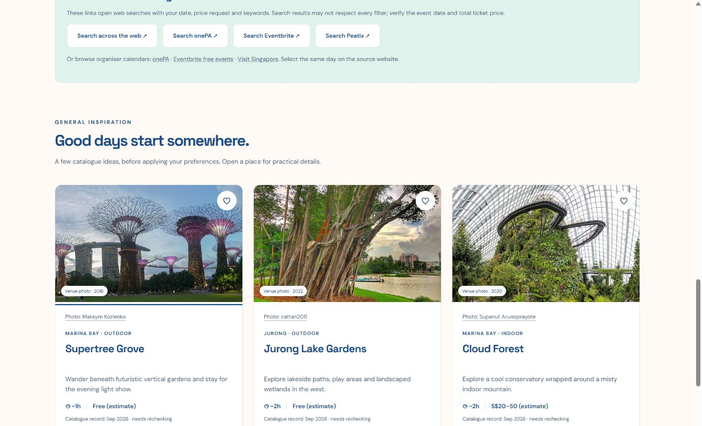

# FunGoWhere

A Singapore outing finder built for a Common Ground hackathon. Match places to your company, time and budget, save ideas, compare options and find free or low-cost events.

## Run locally

Requires Node.js 22.13 or newer; no external packages are required.

```sh
npm run dev
```

Open http://127.0.0.1:4173/ and keep the terminal running. After source changes, rebuild and refresh. `npm run build` produces a static website in `dist/`. Deploy that directory at a website origin root.

```sh
npm test
npm run build
```

## Demo

See [DEMO.md](DEMO.md) for a three-minute presentation and setup checklist.



## Current features

- 61 Singapore places with editable examples and an eight-question guide.
- Rule-based requirements, ranked shortlists with reasons and tradeoffs, and alternative ideas.
- Browser-local saves, comparison, shareable URL state and Maps links.
- Dated event search: free admission or paid admission strictly below S$20, plus external organiser searches.
- Actual photographs for 47 places, photo credits and dates, detail galleries and labelled illustration fallbacks.
- Responsive interface using orange, peach, mint, teal and navy.

## Data and limitations

This is a prototype, not a live booking or event aggregation service. Prices, activity durations and crowd scores are estimates. Only three venues have separately checked practical visitor information. The five curated event records were checked on 11 October 2026; choose that date to demonstrate the curated examples. Links lead to organisers for current details. Saves remain in the current browser and do not sync between devices.

Photographs are historical and do not establish current displays, opening hours or availability. Fourteen venues still use labelled category illustrations. Optional Google Fonts have system fallbacks. Core interactions and bundled photos work locally without internet; external links need a connection.

## Credits and licensing

Photographs retain their individual reuse licences, credits and source links. See [the photo inventory](public/places/venues/PHOTO-ATTRIBUTION.md) and [original venue photo credits](public/places/venues/ATTRIBUTION.md). Image licences apply independently of the application code. Original illustration licensing has not been independently established. No general open-source licence is granted for this repository.

## Project structure

Active application modules are in the project root; static assets are in `public/`. `build.mjs` copies these into `dist/`; `server.mjs` serves the local preview. Tests cover matching, routes, events and photograph metadata. Local experiments, rolled-back redesigns, research downloads and workshop documents are excluded from the repository.
